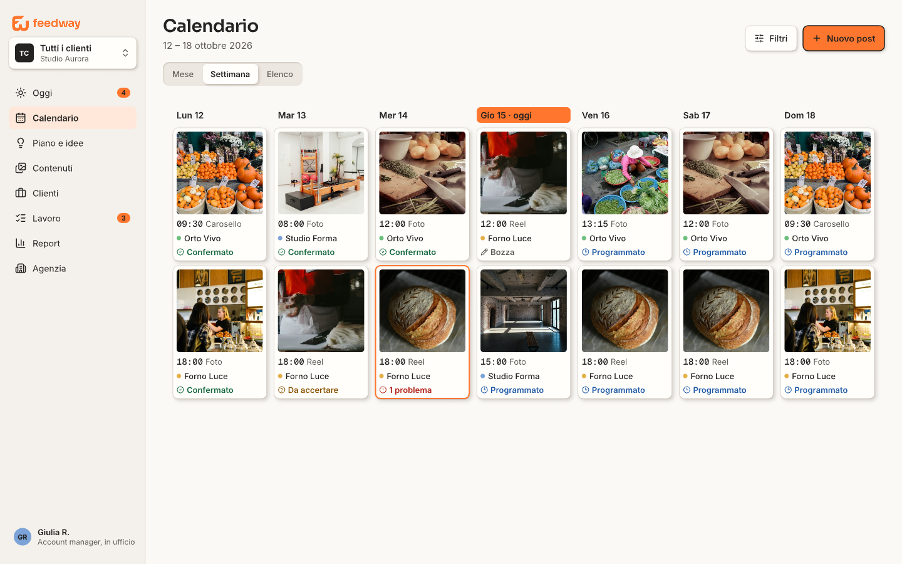
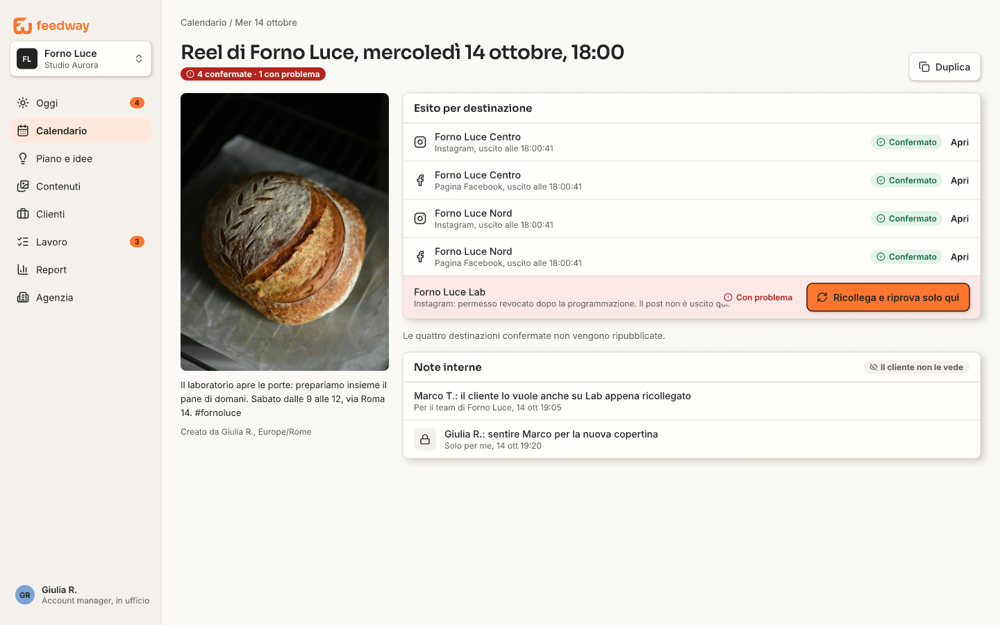
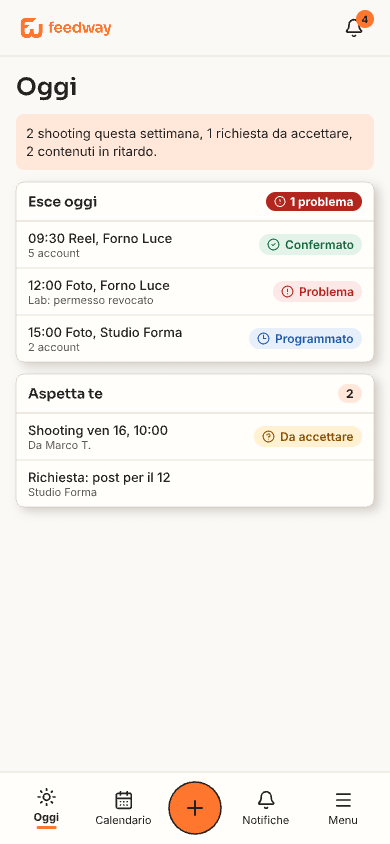
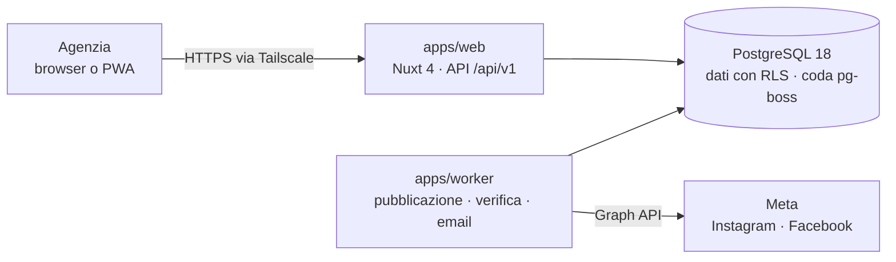

<div align="center">

<picture>
  <source media="(prefers-color-scheme: dark)" srcset="design/assets/feedway-horizontal-bianco.svg">
  
</picture>

### Tutta la tua agenzia, in un solo posto.

Il pannello self-hosted con cui un'agenzia programma, pubblica e controlla i contenuti **Instagram** e **Facebook** di tutti i suoi clienti, tramite le API ufficiali di Meta.


[Funzioni](#funzioni) · [Stato](#stato-del-progetto) · [Avvio rapido](#avvio-rapido) · [Installazione](#installazione-su-una-vps) · [Documentazione](#documentazione) · [Contribuire](#contribuire)

<br>



<sub>Progetto grafico dell'interfaccia (Pencil). L'app lo raggiunge tappa dopo tappa.</sub>

</div>

---

## Perché Feedway

Chi gestisce i social di molti clienti passa la giornata tra account, password, fogli di calcolo e controlli a mano per capire se un post è uscito davvero. Feedway mette tutto in un solo pannello:

- **Un calendario per tutti i clienti**, o per uno alla volta, con anteprima com'è su Meta.
- **Un post, più destinazioni**: gli stessi media su più account Instagram e Pagine Facebook, con caption comune e testo diverso per piattaforma quando serve.
- **Un esito per ogni destinazione**: confermato, in verifica, da accertare o con problema. Se un account fallisce si riprova solo quello, senza ripubblicare ciò che è già uscito.
- **Sul tuo server**: dati, token e media restano sulla tua VPS. Dopo l'installazione tutto si configura dal pannello, senza toccare codice o file.

## Funzioni

Quelle previste dalla versione 1.0, secondo la [specifica](docs/superpowers/specs/2026-10-15-feedway-design.md):

| Area | Cosa fa |
|---|---|
| **Pubblicazione** | Foto, caroselli, reel e storie su Instagram e Pagine Facebook. Controlli prima della pubblicazione, verifica dopo, tentativi senza doppioni. |
| **Pianificazione** | Calendario mese, settimana ed elenco; trascinamento; fasce orarie; programmazione in blocco da file, CSV o Excel; piano editoriale per cliente. |
| **Media** | Upload a pezzi con ripresa, conversioni automatiche (HEIC, video HEVC), libreria con cartelle e tag. |
| **Agenzia e team** | Più clienti e spazi di lavoro, ruoli e permessi, inviti, registro attività. Più agenzie isolate tra loro nello stesso database. |
| **Accesso e privacy** | Passkey o password, 2FA con codici di recupero, dispositivi collegati, "Scarica i miei dati", "Elimina il mio account". |
| **Notifiche** | Centro notifiche, Telegram ed email, ore di silenzio, riepilogo del mattino. |
| **Condivisione** | Link di sola visione per il cliente, con password e scadenza; stampa o PDF del calendario; logo e colori dell'agenzia. |
| **Telefono** | Interfaccia responsive e PWA, con i compiti essenziali a portata di pollice. |

Dopo la 1.0 Feedway diventa l'hub dell'agenzia: clienti e CRM, portale del cliente, shooting, team, cruscotti e report ([direzione decisa](docs/superpowers/specs/2026-10-29-feedway-hub-agenzia.md)).

<table>
  <tr>
    <td width="70%"></td>
    <td width="30%"></td>
  </tr>
  <tr>
    <td><sub>Esito per destinazione: si riprova solo l'account con il problema.</sub></td>
    <td><sub>La giornata dal telefono.</sub></td>
  </tr>
</table>

## Stato del progetto

> [!NOTE]
> Feedway è in sviluppo e non è ancora pronto per l'uso con clienti reali. La 1.0 si costruisce in **12 tappe**, ognuna installabile e provabile sulla VPS.

| Tappa | Contenuto | Stato |
|---|---|---|
| 1 · Fondamenta | Monorepo, database, coda, worker, design system, immagine Docker, `install.sh` e `update.sh`, CI | ✅ Rilasciata (v0.1.x) |
| 2 · Identità | Account, 2FA e passkey, agenzie isolate con RLS, ruoli, inviti, spazi di lavoro, privacy | 🚧 In corso |
| 3 · Meta | Collegamento degli account Instagram e Facebook | 📝 Piano scritto |
| 4–12 | Media, regole, post, pubblicazione, notifiche, pianificazione, condivisione, operazioni, messa in produzione | ⏳ Da fare |

Dettaglio di ogni tappa nel [piano generale](docs/superpowers/plans/2026-10-15-00-piano-generale.md); cosa è uscito in ogni versione nel [CHANGELOG](CHANGELOG.md).

## Architettura

Un **monolite modulare** ([ADR 001](docs/adr/001-monolite-modulare.md)): un pannello web e un worker che condividono dominio e casi d'uso, con PostgreSQL come unico servizio di stato, anche per la coda dei lavori ([ADR 002](docs/adr/002-coda-su-postgres.md)).



- **Livelli**: `domain → application → infrastructure / apps`. Il dominio non importa nulla di esterno e dependency-cruiser blocca la CI se un confine viene violato.
- **Isolamento tra agenzie** a doppia barriera: permessi nell'applicazione più Row Level Security nel database ([ADR 004](docs/adr/004-autorizzazione-e-rls.md)), con una batteria di test dedicata.
- **API-first**: ogni funzione è un caso d'uso esposto da `/api/v1` ([ADR 006](docs/adr/006-api-first.md)).
- **Segreti cifrati** nel database con chiavi per organizzazione ([ADR 007](docs/adr/007-segreti-cifrati-nel-database.md)).

### Stack

| | |
|---|---|
| Runtime e linguaggio | Node 24 LTS, TypeScript 6.0 |
| Interfaccia | Nuxt 4, Nuxt UI 4, Tailwind CSS 4 |
| Dati | PostgreSQL 18, Drizzle, pg-boss |
| Accesso | Better Auth (passkey, 2FA), argon2id |
| Validazione | Zod |
| Test | Vitest, Testcontainers, Playwright, axe |
| Monorepo | pnpm, Turborepo |
| Rilascio | Docker Compose, immagine su GHCR per amd64 e arm64, release-please |

Ogni componente con le alternative valutate: [docs/stack.md](docs/stack.md).

### Struttura del repository

```
apps/
  web/           pannello e API (Nuxt)
  worker/        lavori in background e migrazioni
packages/
  domain/        regole del dominio, senza dipendenze esterne
  application/   casi d'uso e porte
  infrastructure/ database, autenticazione, email, archiviazione
  config/        configurazione validata
  contracts/     schemi condivisi delle API
  ui/            componenti e token del design system
tools/           regole di lint e fixture dei confini
docker/          immagine, compose, Postgres, Tailscale
scripts/         installazione, aggiornamento, CI locale
design/          marchio, progetto grafico in Pencil, tavole, brief
docs/            specifica, piani, ADR, runbook, convenzioni
```

## Avvio rapido

**Requisiti:** Node 24.11 o successivo, pnpm 12 (con Corepack), Docker.

```bash
git clone https://github.com/grecomatteo/Feedway.git && cd Feedway
corepack enable
pnpm install

pnpm verify       # formato, lint, tipi, confini, test unitari
pnpm test:int     # integrazione su un Postgres reale in un container
pnpm test:e2e     # end-to-end: avvia il pannello su un database di prova
pnpm verify:ci    # tutti i controlli della CI, da lanciare prima di ogni push
```

Le variabili d'ambiente sono descritte in [`.env.example`](.env.example). Per un Postgres locale:

```bash
docker compose --project-directory . -f docker/compose.yml -f docker/compose.dev.yml up -d postgres
```

> [!IMPORTANT]
> Sviluppo e test non usano mai account Meta reali: il client della Graph API lavora in modalità `mock` (`META_MODE=mock`).

## Installazione su una VPS

Feedway gira con Docker Compose su una VPS Linux (x64 o ARM) e il pannello si raggiunge solo dalla tua rete [Tailscale](https://tailscale.com).

```bash
git clone https://github.com/grecomatteo/Feedway.git /opt/feedway && cd /opt/feedway
git checkout v0.1.2            # sempre una versione con tag, mai main
./scripts/install.sh           # chiede nome host e chiave Tailscale, email dell'Owner
```

Lo script genera chiavi e password, avvia i container e stampa l'indirizzo del pannello. Gli aggiornamenti eseguono prima la migrazione e tornano indietro con un comando:

```bash
./scripts/update.sh v0.2.0     # o senza argomenti per l'ultima release
./scripts/update.sh --rollback
```

Prerequisiti, accessi finché il repository è privato, segreti e backup: [runbook di installazione](docs/runbooks/installazione.md). Poi imposta l'[email di sistema](docs/runbooks/email-di-sistema.md).

## Documentazione

| Documento | A cosa serve |
|---|---|
| [Specifica](docs/superpowers/specs/2026-10-15-feedway-design.md) | Cosa fa la piattaforma e come è fatta: la fonte di verità |
| [Hub per l'agenzia](docs/superpowers/specs/2026-10-29-feedway-hub-agenzia.md) | La direzione dopo la 1.0 |
| [Piano generale](docs/superpowers/plans/2026-10-15-00-piano-generale.md) | Le 12 tappe, le interfacce tra tappe, le regole comuni |
| [Decisioni architetturali (ADR)](docs/adr/README.md) | Ogni scelta importante con le alternative scartate |
| [Stack](docs/stack.md) | Componenti, versioni e alternative valutate |
| [Convenzioni](docs/convenzioni.md) · [Moduli](docs/moduli.md) | Regole di codice e ricetta per un modulo nuovo |
| [Flusso Git](docs/flusso-git.md) | Rami, commit, PR, protezione di `main`, rilasci |
| [Runbook](docs/runbooks/) | Installazione, email di sistema, impostazioni GitHub |
| [Design](DESIGN.md) · [Prodotto](PRODUCT.md) · [Marchio](design/brief-feedway/brand/Feedway-Brand-Kit-v1.0/GUIDA-DEL-MARCHIO.md) | Scelte grafiche, contesto di prodotto, guida del marchio |
| [Indice completo](docs/README.md) | Tutti gli altri documenti |

## Contribuire

Il lavoro parte sempre da un task del piano o da una issue. In breve:

1. Ramo corto da `main`, per esempio `feat/02-login`.
2. Test prima del codice, commit in [Conventional Commits](https://www.conventionalcommits.org/it/v1.0.0/) in italiano.
3. `pnpm verify:ci` verde, poi una PR piccola secondo il [modello](.github/pull_request_template.md).
4. CI verde, revisione, squash merge.

Le regole complete sono in [CONTRIBUTING.md](CONTRIBUTING.md) e nel [flusso Git](docs/flusso-git.md); gli agenti di programmazione leggono anche [AGENTS.md](AGENTS.md).

## Sicurezza

Hai trovato una vulnerabilità? Non aprire una issue pubblica: segui [SECURITY.md](SECURITY.md) per una segnalazione privata.

## Licenza

Software proprietario, tutti i diritti riservati. Vedi [LICENSE](LICENSE).
